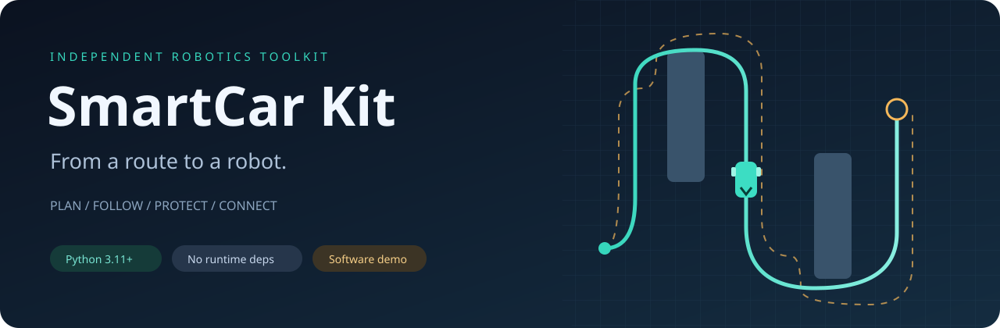
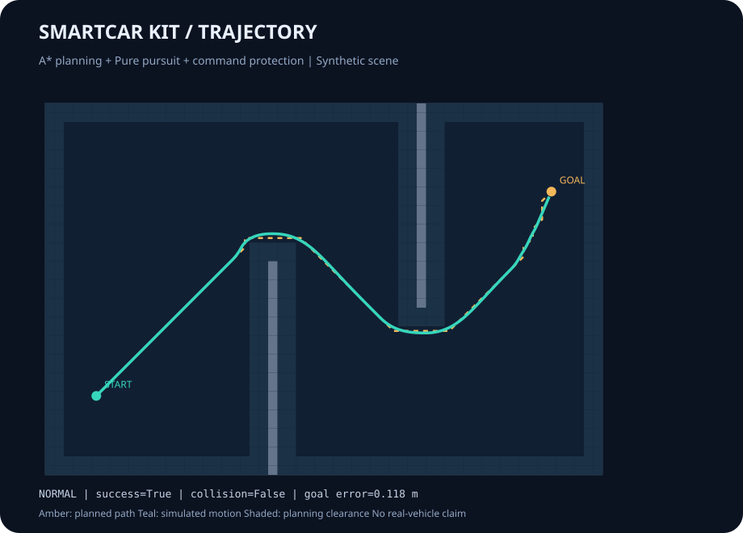

# SmartCar Kit



_From a route to a robot. An independently written, AI-assisted mobile robot toolkit._

[中文说明](README.md) · [Architecture](docs/architecture.md) · [Protocol](docs/protocol.md) · [Origin](ORIGIN.md)

## 🚀 Run the demo

Python 3.11+ is required. There are no third-party runtime dependencies. Download
the repository and run these commands from its root:

```bash
python -m smartcar_kit demo --config examples/demo.toml
python -m smartcar_kit protocol-demo
```

On Ubuntu, use `python3` if needed. Open `outputs/demo/replay.html` for a
self-contained trajectory replay, or inspect `run.json` and `trajectory.svg`.



## 🧩 Included modules

| Module | Responsibility |
| --- | --- |
| `planning` | Inflated occupancy grid, eight-connected A*, no corner cutting |
| `control` | Forward-only pure pursuit, turn slowdown, goal stopping |
| `mission` | Explicit idle / ready / running / paused / completed / fault states |
| `commands` | Fresh manual commands override autonomy; stale commands expire |
| `safety` | Latched emergency stop, stale observation checks, directional obstacle checks, command limits |
| `chassis` | Differential wheel rates and Ackermann steering conversion |
| `protocol` | New example binary frames, sequence numbers, CRC, incremental parsing |
| `runtime` | Composition with a single protected command outlet |
| `simulation` / `report` | Synthetic world, collision checks, JSON, SVG and HTML replay |

## 🧪 Verify behavior

```bash
python -m unittest discover -s tests -v
python tools/check_repository.py
python -m smartcar_kit demo --scenario obstacle --output outputs/obstacle
python -m smartcar_kit demo --scenario stale --output outputs/stale
python -m smartcar_kit demo --scenario estop --output outputs/estop
```

In fault scenarios, success means the expected stop was observed, not that the
robot reached its destination. See the [validation record](docs/validation.md)
for evidence and limitations. The repository includes a Windows/Ubuntu CI
configuration; a configuration is not a claim that remote CI has already run.

## 🔌 Hardware and extension

The simulator uses ideal pose, synthetic scans and unicycle motion. It does not
validate physical braking, localization, motor control or Ackermann feasibility.
Vendor drivers, ROS bridges, camera processing, learned networks, serial I/O,
and microcontroller firmware are not included. Chassis conversions and the new
wire format are building blocks for your own adapters, not compatibility claims.

The architecture and hardware guides explain units, timestamps, command flow,
mode switching, steering saturation and the lower-level watchdog requirement.

## 🤝 Origin and license

This implementation and its synthetic assets were created for this repository
with AI assistance. No previous team source, private data, model or image was
imported. General algorithm references and accurate project wording are in
[ORIGIN.md](ORIGIN.md). Contributions should include a runnable example and
truthful validation scope; see [CONTRIBUTING.md](CONTRIBUTING.md).

Released under the [MIT license](LICENSE).
