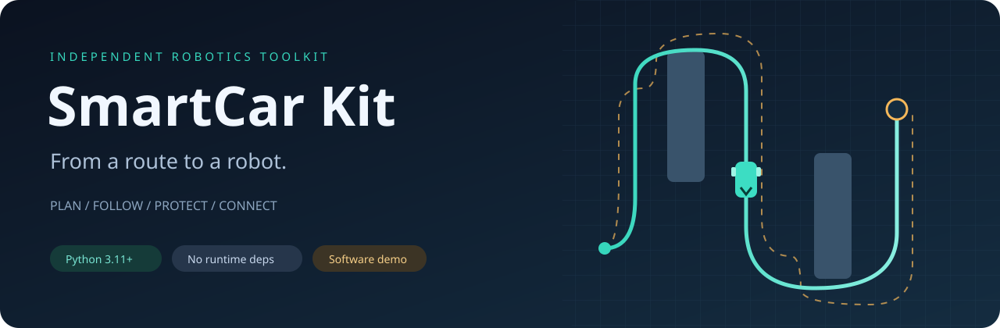
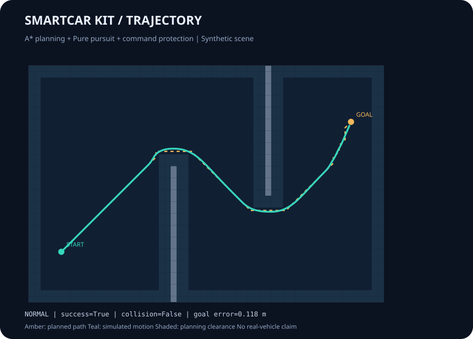
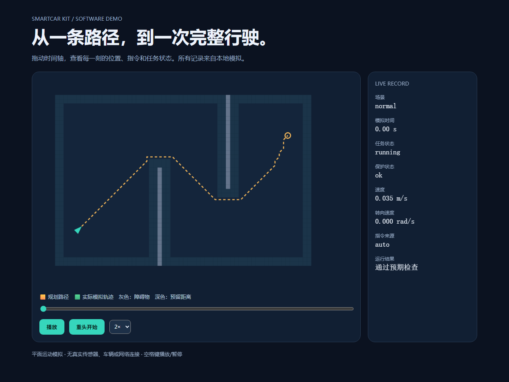
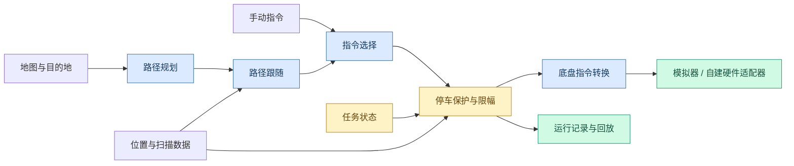

# SmartCar Kit



<p align="center">
  
  
  <a href="LICENSE"></a>
  
</p>

<p align="center"><b>从地图到路径，从目标到运动，把小车系统拆成看得懂、换得掉、能演示的模块。</b></p>
<p align="center"><a href="README.en.md">English</a> · <a href="#-快速开始">快速开始</a> · <a href="docs/architecture.md">结构与接口</a> · <a href="docs/hardware.md">接入自己的车</a> · <a href="docs/protocol.md">通信说明</a></p>

SmartCar Kit 是一套面向学习、课程实验和个人原型的移动机器人软件。它把**路径规划、运动控制、任务流程、停车保护、底盘转换与通信**放在同一条可运行链路中，每部分也能单独使用。

项目起点是对智能车系统分工的学习。这里的代码、示例地图、通信格式和展示素材均为本项目新写，使用 AI 辅助开发；不包含原团队仓库的源码、训练数据、模型、截图或车辆配置。具体说明见 [项目来源](ORIGIN.md)。

## 🧭 可以用它做什么

| 你关心的问题 | 已实现的功能 | 独立模块 |
| --- | --- | --- |
| 车从哪里走到哪里？ | 栅格 A*、障碍膨胀、禁止贴角穿越 | `planning.py` |
| 怎么沿着路径开？ | Pure pursuit、转弯减速、接近终点减速、到点停止 | `control.py` |
| 什么时候允许开？ | 待机、就绪、运行、暂停、完成、故障 | `mission.py` |
| 手动与自动谁说了算？ | 手动优先、指令到期失效、切换时清除旧指令 | `commands.py` |
| 异常时怎么停？ | 急停保持、输入超时、方向障碍检查、速度和加速度限制 | `safety.py` |
| 换一种底盘怎么办？ | 差速轮速与车体速度互转、阿克曼转角转换 | `chassis.py` |
| 上下位机怎么传指令？ | 自定义二进制帧、序号、CRC、分包粘包与损坏恢复 | `protocol.py` |
| 怎么串起来观察效果？ | 单一指令出口、二维模拟、记录导出、浏览器回放 | `runtime.py` / `simulation.py` |

核心只使用 Python 标准库。运行演示无需 ROS、显卡、相机、雷达或实体小车。

## 🚀 快速开始

### 1. 下载并进入项目

下载仓库 ZIP 后解压，在项目目录打开终端。检查 Python 版本：

```bash
python --version
```

需要 Python **3.11 或更高版本**。Ubuntu 如果使用 `python3`，将下面的 `python` 替换成 `python3`。

### 2. 运行完整演示

```bash
python -m smartcar_kit demo --config examples/demo.toml
```

终端应显示 `"success": true`、`"collision": false` 和 `"state": "completed"`。随后打开 `outputs/demo/replay.html`，可以播放、暂停、拖动时间轴和切换速度。

| 生成文件 | 用途 |
| --- | --- |
| `outputs/demo/replay.html` | 不联网即可打开的交互回放 |
| `outputs/demo/trajectory.svg` | 本次运行的路径与轨迹图 |
| `outputs/demo/run.json` | 逐帧位置、指令、任务和保护状态 |

### 3. 试试异常场景

```bash
python -m smartcar_kit demo --scenario obstacle --output outputs/obstacle
python -m smartcar_kit demo --scenario stale --output outputs/stale
python -m smartcar_kit demo --scenario estop --output outputs/estop
python -m smartcar_kit protocol-demo
```

异常在模拟时间 3 秒时注入。`success` 的含义是“出现预期停车行为”，不代表异常场景到达了终点。最后一条命令仅在内存中演示通信，不会连接设备或开启网络端口。

## 🎬 看一次真实的程序输出



*黄色虚线为规划路径，绿色为模拟运动轨迹，灰色为障碍物，周围深色区域为规划预留距离。此图由本仓库程序生成，不是实车测试画面。*

默认场景中，车辆从左下方出发，绕过两面墙，再到达右上方目标。具体结果见 [软件检查记录](docs/validation.md)。

演示采用理想定位、合成扫描和无惯性的平面运动模型，不能据此推断真实车辆的定位精度、刹车距离、操控稳定性或比赛表现。

<details>
<summary>查看本地回放界面</summary>



*回放完全在本地运行。路径、车辆位置和右侧数值均来自本次模拟记录。*

</details>

---

## 🏗️ 各部分怎样连接



所有实际输出应经过 `RobotRuntime` 内部的统一保护检查。单独调用控制算法得到的是候选指令，不能绕过检查直接发给车。

### 目录导览

```text
smartcar-modular-kit/
├── smartcar_kit/
│   ├── messages.py       # 坐标、速度、扫描与时间约定
│   ├── planning.py       # 地图、障碍预留距离与 A*
│   ├── control.py        # 路径跟随与目标到达
│   ├── mission.py        # 任务阶段及允许的切换
│   ├── commands.py       # 手动/自动指令选择
│   ├── safety.py         # 停车保护、超时和限幅
│   ├── chassis.py        # 差速 / 阿克曼底盘转换
│   ├── protocol.py       # 独立设计的通信帧
│   ├── runtime.py        # 将模块组合成一个控制周期
│   ├── simulation.py    # 合成场景、传感器和运动模拟
│   ├── report.py        # 记录、轨迹图和 HTML 回放
│   └── __main__.py      # 演示命令入口
├── examples/            # 配置和最小使用例子
├── tests/               # 关键行为与整条流程的检查
├── docs/                # 结构、硬件接入、通信和验证范围
├── assets/              # 原创封面及程序生成的示例图
├── tools/               # 文档与文件检查
├── .github/workflows/   # 提交后的自动检查配置
├── ORIGIN.md            # 项目来源与贡献说明
└── LICENSE              # MIT 使用许可
```

## 🧩 单独使用一个模块

例如，只使用规划与路径跟随：

```python
from smartcar_kit.planning import GridMap, astar
from smartcar_kit.control import PurePursuit, PursuitConfig
from smartcar_kit.messages import Pose2D

grid = GridMap(30, 20, resolution=0.2)
cells = astar(grid.inflate(0.2), start=(3, 3), goal=(25, 15))
path = [grid.world(cell) for cell in cells]
follower = PurePursuit(path, PursuitConfig(cruise_speed=0.3))
candidate = follower.step(Pose2D(*path[0], yaw=0.0))
print(candidate)
```

完整组合方式见 [最小控制循环](examples/control_loop.py)，可在根目录执行：

```bash
python -m examples.control_loop
```

如需在其他目录导入项目，可以在自己的虚拟环境中安装：

```bash
python -m pip install -e .
```

这一步可能下载构建工具，但运行演示本身不需要安装额外库。

## ⚙️ 调整配置与接入硬件

| `examples/demo.toml` 中的字段 | 默认值 | 含义 |
| --- | --- | --- |
| `resolution` | `0.2` | 每个地图格子的边长，米 |
| `robot_radius` | `0.16` | 模拟碰撞检查使用的圆形半径，米 |
| `planning_clearance` | `0.4` | 规划时额外预留的距离，米，向上取整到格子 |
| `dt` | `0.05` | 每个模拟周期，秒 |
| `speed` | `0.45` | 路径跟随的期望速度，米/秒 |
| `lookahead` | `0.42` | 路径跟随的前视距离，米 |
| `max_steps` | `2500` | 最大模拟步数，超出后返回失败 |

修改分辨率会同时缩放固定示例地图的物理大小；地图结构目前写在 `demo_world()` 中。

接入实体车时，需要自己提供位置来源、扫描来源和设备收发适配器。当前只提供通用底盘数学转换与示例通信格式，**没有声称已兼容某款雷达、STM32 固件或 RDK X5**。接入步骤与阿克曼转弯限制见 [硬件指南](docs/hardware.md)。

## 🧪 怎么确认程序能用

```bash
python -m unittest discover -s tests -v
python tools/check_repository.py
```

检查覆盖规划绕障、贴角限制、任务切换、手动指令过期、急停保持、输入超时、异常扫描、底盘换算和通信损坏恢复。整条流程还运行正常、遇障、信息过期、急停四种场景。

仓库包含 Windows / Ubuntu、Python 3.11 / 3.13 的自动检查配置。配置存在不等于已经在线运行；本地实际检查结果与环境单独记录在 [validation.md](docs/validation.md)。

### 常见问题

| 问题 | 处理办法 |
| --- | --- |
| 提示找不到 `smartcar_kit` | 回到项目根目录再执行命令，或安装到当前虚拟环境 |
| Ubuntu 没有 `python` 命令 | 使用 `python3` |
| 想看动画但 GitHub 只显示源码 | 先本地运行，再打开生成的 `replay.html` |
| 修改参数后 `success` 为 `false` | 查看回放中的保护原因；并非任意速度、尺寸组合都可走通 |
| 急停后重置任务还是不能动 | 急停保持与任务状态分开，需要明确解除急停再重新启动 |
| 想直接换到实车 | 先完成设备适配与低速测试，模拟不会验证真实刹车能力 |

## 🤝 贡献、来源与许可

欢迎补充新地图、控制方法、传感器适配和真实硬件检查记录。每次扩展请附带一个能运行的例子，并写清楚验证环境，见 [贡献指南](CONTRIBUTING.md)。

本项目采用 [MIT 许可](LICENSE)。项目来源与 AI 辅助开发说明见 [ORIGIN.md](ORIGIN.md)。这份许可针对本仓库新写的内容，不为任何旧团队项目重新授权。MIT 允许他人在保留许可说明的前提下使用、修改和分发，也允许商业使用。[^1]

Pure pursuit 是已有的公开控制方法，算法出处见 Coulter 的报告；本项目实现不复制报告或外部仓库源码。[^2] 栅格 A* 是通用搜索方法，本项目不将它描述为原创算法创新。

[^1]: Open Source Initiative. “The MIT License.” https://opensource.org/license/mit
[^2]: R. Craig Coulter. (1992). “Implementation of the Pure Pursuit Path Tracking Algorithm.” CMU-RI-TR-92-01. https://publications.ri.cmu.edu/implementation-of-the-pure-pursuit-path-tracking-algorithm
